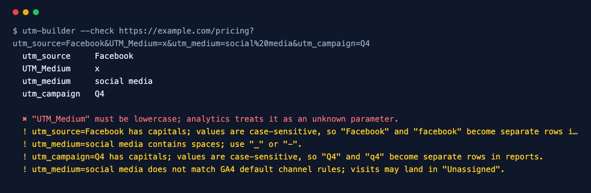
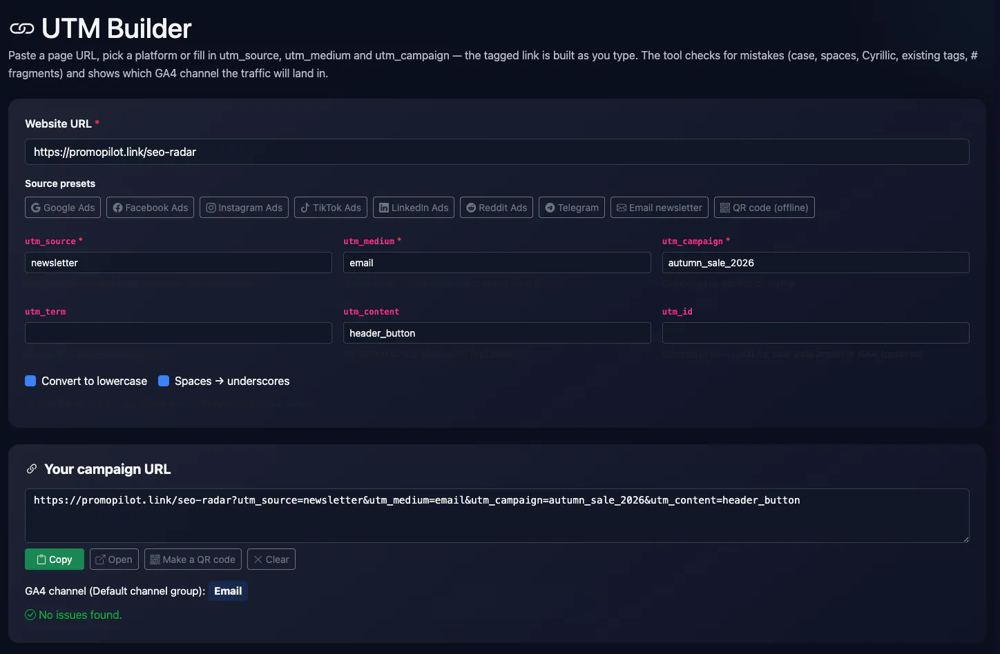
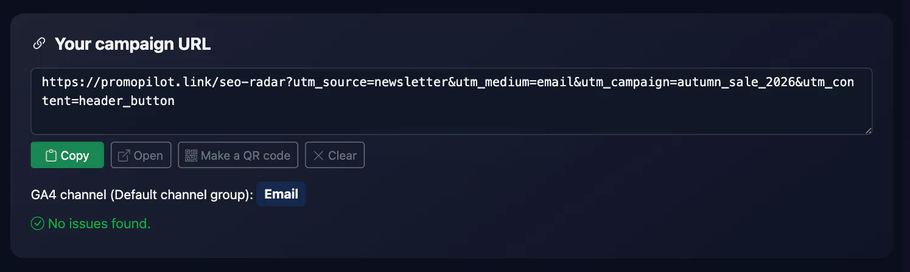
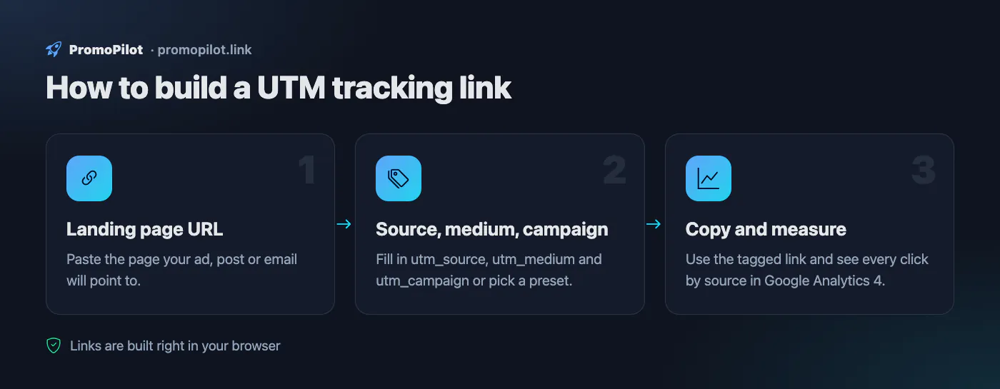

<div align="center">

# UTM Builder

**Tag campaign links consistently and catch UTM mistakes before they hit analytics.**

[](https://github.com/ksanyok/utm-builder/actions/workflows/ci.yml) [](LICENSE)   [](https://promopilot.link/en/tools/utm-builder.php?utm_source=github&utm_medium=repo&utm_campaign=tools&utm_content=utm-builder)

**[▶ Use the free online version — no install, no sign-up](https://promopilot.link/en/tools/utm-builder.php?utm_source=github&utm_medium=repo&utm_campaign=tools&utm_content=utm-builder)**

</div>

`utm-builder` adds UTM parameters to links the same way every time — lowercase, no spaces, existing query and `#fragment` preserved — and checks already tagged links for the mistakes that split or lose traffic in Google Analytics 4: missing `utm_source`/`utm_medium`/`utm_campaign`, `UTM_Source` with capitals, duplicated keys, spaces, parameters hidden after `#` and mediums that GA4 cannot map to a channel.



## What it checks

- `utm_source`, `utm_medium` and `utm_campaign` are all present — GA4 needs all three
- Keys are lowercase (`UTM_Source` is not recognised) and standard; no key appears twice
- Values have no capitals or spaces, so `Facebook`, `facebook` and `face book` do not become three sources
- `utm_medium` matches GA4 default channel rules (`cpc`, `email`, `social`, `referral`, `display`…) instead of landing in *Unassigned*
- No UTM parameters after `#`, where browsers never send them to the server
- Building keeps existing query parameters and the fragment, and replaces old UTM values instead of duplicating them

## Why it matters

UTM tags are the only way analytics knows which newsletter, ad or post brought a visitor. They are typed by hand by different people, so the same campaign ends up as `Newsletter`, `newsletter` and `news letter` — three rows in every report — and a medium like `e-mail-blast` drops the traffic into *Unassigned*. These mistakes cannot be fixed retroactively: the data is collected wrong. Generating links with one tool and checking them before sending keeps reports clean.

## Quick start

```bash
# run straight from GitHub, nothing to install
npx github:ksanyok/utm-builder https://example.com --source newsletter --medium email --campaign spring_sale

# or install the CLI globally
npm install -g github:ksanyok/utm-builder
utm-builder https://example.com --source newsletter --medium email --campaign spring_sale
```

Check a link someone sent you:

```bash
utm-builder --check "https://example.com/?utm_source=Facebook&utm_medium=Social Media"
```

Tag a list of links (one per line, optional ",source"):

```bash
utm-builder --batch links.txt --medium email --campaign october_digest > tagged.txt
```

Keep the original case and use dashes:

```bash
utm-builder https://example.com --source LinkedIn --medium social --campaign "Q4 Launch" --keep-case --separator -
```

## Example output

```text
$ utm-builder --check https://example.com/pricing?utm_source=Facebook&UTM_Medium=x&utm_medium=social media&utm_campaign=Q4
  utm_source     Facebook
  UTM_Medium     x
  utm_medium     social media
  utm_campaign   Q4

  ✖ "UTM_Medium" must be lowercase; analytics treats it as an unknown parameter.
  ! utm_source=Facebook has capitals; values are case-sensitive, so "Facebook" and "facebook" become separate rows in reports.
  ! utm_medium=social media contains spaces; use "_" or "-".
  ! utm_campaign=Q4 has capitals; values are case-sensitive, so "Q4" and "q4" become separate rows in reports.
  ! utm_medium=social media does not match GA4 default channel rules; visits may land in "Unassigned".
```

## CLI

```text
Usage: utm-builder <url> --source <s> --medium <m> --campaign <c> [options]
       utm-builder --check <url>
       utm-builder --batch links.csv --medium email --campaign spring_sale

Adds UTM parameters to a URL (normalised to lowercase, spaces → "_") or checks
an existing tagged URL for mistakes that break analytics attribution.

Options:
  --source, --medium, --campaign, --term, --content, --id   UTM values
  --keep-case        Do not lowercase values
  --separator <c>    Replacement for spaces (default: "_")
  --check <url>      Lint the UTM parameters of an existing URL
  --batch <file>     Tag every URL in a file (one per line, or "url,source" CSV)
  --json             Print JSON
  --strict           Exit with code 1 on warnings too (with --check)
  -h, --help         Show this help

Online version (no install): https://promopilot.link/en/tools/utm-builder.php?utm_source=github&utm_medium=cli&utm_campaign=tools&utm_content=utm-builder
```

## Use as a library

```js
import { buildUtmUrl, parseUtmUrl, lintUtm } from '@promopilot/utm-builder';

const url = buildUtmUrl('https://example.com/pricing', { source: 'newsletter', medium: 'email', campaign: 'Spring Sale' });
// https://example.com/pricing?utm_source=newsletter&utm_medium=email&utm_campaign=spring_sale

parseUtmUrl(url);  // { base: 'https://example.com/pricing', utm: { utm_source: ... }, other: {} }
lintUtm(url);      // [] — or [{ level, code, message }]
```

`buildUtmUrl(url, params, { lowercase, separator })` accepts keys with or without the `utm_` prefix and throws on unknown ones. `lintUtm(url)` returns stable issue codes: `missing-source`, `missing-medium`, `missing-campaign`, `uppercase-key`, `duplicate-key`, `unknown-key`, `mixed-case`, `spaces`, `custom-medium`, `utm-in-fragment`, `invalid-url`.

## Use in CI (GitHub Actions)

Check the tagged links in an email template or landing page config before it ships:

```yaml
on: [pull_request]
jobs:
  utm:
    runs-on: ubuntu-latest
    steps:
      - uses: ksanyok/utm-builder@v1
        with:
          args: --check "https://example.com/?utm_source=newsletter&utm_medium=email&utm_campaign=launch" --strict
```

## How it works

Everything runs locally with the WHATWG `URL` and `URLSearchParams` APIs built into Node.js — no network requests. Building sets each parameter with `searchParams.set`, so an existing value is replaced rather than duplicated and other parameters and the fragment stay untouched. The linter reads raw keys (to catch wrong case and duplicates) and the decoded values, and compares `utm_medium` against the medium values used by GA4 default channel group rules.

## CLI vs. online version

| | This package | [Online tool](https://promopilot.link/en/tools/utm-builder.php?utm_source=github&utm_medium=repo&utm_campaign=tools&utm_content=utm-builder) |
|---|---|---|
| Runs on | Your machine, CI, scripts | Any browser |
| Batch tagging | Yes, `--batch` from a file | One link at a time |
| Validation | `--check` with exit codes | Live preview |
| Extras | Library API for your own tools | QR code and short-link friendly output |
| Price | Free, MIT | Free, no sign-up |







## FAQ

<details>
<summary><b>Which UTM parameters are required?</b></summary>

For GA4 attribution use `utm_source`, `utm_medium` and `utm_campaign` on every link. `utm_term`, `utm_content` and `utm_id` are optional.
</details>

<details>
<summary><b>Why lowercase everything?</b></summary>

Analytics values are case-sensitive: `Facebook` and `facebook` are reported as different sources. Lowercasing every value is the simplest way to stay consistent across a team.
</details>

<details>
<summary><b>Should I tag internal links on my own site?</b></summary>

No. UTM parameters on internal links start a new session and overwrite the original source, so the real channel is lost.
</details>

<details>
<summary><b>What medium should I use?</b></summary>

Use the values GA4 maps to channels: `cpc` for paid search, `email`, `social` (or `paid_social` style values via campaign naming), `referral`, `display`, `affiliate`. Custom mediums end up in *Unassigned*.
</details>

<details>
<summary><b>Can UTM tags hurt SEO?</b></summary>

Tagged URLs can be crawled as duplicates if they are linked publicly. Use a canonical tag on the landing page; never put UTM tags in your sitemap or internal navigation.
</details>

<details>
<summary><b>Is there a version without installing anything?</b></summary>

Yes — the [online UTM Builder](https://promopilot.link/en/tools/utm-builder.php?utm_source=github&utm_medium=repo&utm_campaign=tools&utm_content=utm-builder) runs the same checks in the browser and explains each result.
</details>

## Related free tools

- [Redirect Checker](https://promopilot.link/en/tools/redirect-checker.php?utm_source=github&utm_medium=repo&utm_campaign=tools&utm_content=redirect-checker) — follow redirect chains and status codes
- [serp-preview](https://promopilot.link/en/tools/serp-preview.php?utm_source=github&utm_medium=repo&utm_campaign=tools&utm_content=serp-preview)
- [og-debugger](https://promopilot.link/en/tools/og-debugger.php?utm_source=github&utm_medium=repo&utm_campaign=tools&utm_content=og-debugger)
- [Sitemap Analyzer](https://promopilot.link/en/tools/sitemap-analyzer.php?utm_source=github&utm_medium=repo&utm_campaign=tools&utm_content=sitemap-analyzer) — validate XML sitemaps and sitemap indexes
- [Robots.txt Checker](https://promopilot.link/en/tools/robots-checker.php?utm_source=github&utm_medium=repo&utm_campaign=tools&utm_content=robots-checker) — test robots.txt rules against any URL
- [All 120+ free SEO, email and web tools](https://promopilot.link/en/tools/?utm_source=github&utm_medium=repo&utm_campaign=tools&utm_content=utm-builder)

## Contributing

Bug reports and pull requests are welcome — see [CONTRIBUTING.md](CONTRIBUTING.md). Security issues: [SECURITY.md](SECURITY.md).
More docs live in the [wiki](https://github.com/ksanyok/utm-builder/wiki) (sources in [docs/wiki](docs/wiki)).

## License

[MIT](LICENSE) © 2026 Alexandr Krikun

---

<sub>Built and maintained by the team behind [PromoPilot](https://promopilot.link/?utm_source=github&utm_medium=repo&utm_campaign=tools&utm_content=utm-builder) — link building, SEO monitoring and 120+ free tools for site owners. Also on [YouTube](https://www.youtube.com/channel/UCPB8m7BgaexcZh0Vr49ViYA).</sub>
